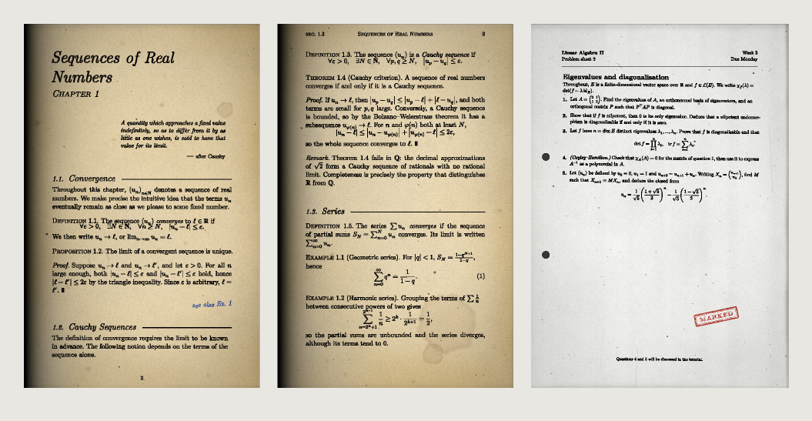
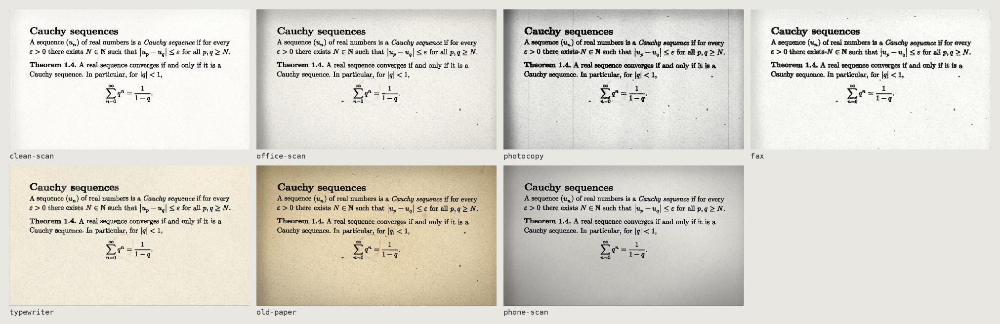

# lookscanned

_Scanned, photocopied, faxed and typewritten looks for Typst documents_

[](https://github.com/kornstein/lookscanned/actions/workflows/ci.yml)
[](https://kornstein.github.io/lookscanned/)
[](https://typst.app)
[](src/)
[](LICENSE)

Paper grain, foxing, coffee stains, scanner shadows, drum bands, fax lines and bleeding ink, applied to any Typst
document with one show rule. Textures and randomness come from a small Rust plugin compiled to WebAssembly; the
effects themselves are plain Typst, so the text stays selectable, the layout does not move and every render is
reproducible from its seed.



> [!NOTE]
>
> This project is still under development. If you encounter an error, you can report it to us by opening an issue.


## Features

- **7 presets**: `clean-scan`, `office-scan`, `photocopy`, `fax`, `typewriter`, `old-paper` and `phone-scan`.
- **Real text**: glyphs are never rasterised. Ink effects replace their fill and stroke with seamless textures, so
  text and equations remain searchable, copyable and accessible.
- **Stable layout**: page rotation is emulated block by block without reflow. The test suite checks that every
  preset keeps the exact line breaks of the clean document.
- **Mathematics-aware**: equations are inked like the surrounding text and work with templates such as
  [mousse-notes](https://typst.app/universe/package/mousse-notes/).
- **Deterministic**: everything derives from an integer `seed`, the page number and the content.
- **Fine control**: 28 settings in 7 themes, a global `intensity`, per-page overrides, partial regions, stamps,
  handwritten notes and raw textures.

## Installation

```typst
#import "@preview/lookscanned:0.1.0"
```

## Usage

```typst
#import "@preview/lookscanned:0.1.0"

#show: lookscanned.scan.with(preset: "old-paper", seed: 3)

= Cauchy sequences
A sequence $(u_n)$ is a _Cauchy sequence_ if for every $epsilon > 0$ there
exists $N$ such that $abs(u_p - u_q) <= epsilon$ for all $p, q >= N$.
```

Scale a preset with `intensity`, override any setting by theme, or change a single page:

```typst
#show: lookscanned.scan.with(
  preset: "photocopy",
  intensity: 0.8,
  ink: (bleed: 0.4, wear: 0.2),
  edges: (punch-holes: true),
)

#lookscanned.page(stains: (amount: 1), skew: (page-rotation: 2deg))[
  = Appendix
]

#lookscanned.stamp("Library copy", at: (x: 60%, y: 80%))
```



The [documentation](https://kornstein.github.io/lookscanned/) covers every setting, the API reference, the
rendering pipeline and the known limitations.

## Building from source

You need Rust with the `wasm32-unknown-unknown` target, Typst 0.14 or later and
[just](https://github.com/casey/just). `wasm-opt` (binaryen) and `pdftotext` (poppler) are optional.

```shell
just toolchain      # add the wasm32-unknown-unknown target
just build          # compile the plugin to typst/lookscanned.wasm
just test           # unit tests, compile tests/ and examples/, layout invariance
just lint           # rustfmt and clippy, warnings as errors
just install-local  # install as @local/lookscanned:<version>
```

There are more recipes for packaging and documentation:

- `just package` assembles `dist/lookscanned/<version>/` and `just check` compiles a document against it.
- `just publish` copies the package into a clone of [typst/packages](https://github.com/typst/packages)
  (`TYPST_PACKAGES`, default `../typst-packages`).
- `just readme-images` re-renders `assets/` from the examples (requires Ghostscript).
- `just docs-serve` and `just docs-build` preview and build the [Zensical](https://zensical.org) site.

During development, documents import the sources directly and are compiled with `typst compile --root .`:

```typst
#import "/typst/lib.typ" as lookscanned
```

The version is defined once in `Cargo.toml`; `typst.toml` is generated from `typst/typst.toml.in`.

## Project layout

```
lookscanned
├── src/
│   ├── texture/      # paper, grain, toner, ink, stains, dust, lines, edges
│   ├── rng.rs        # SplitMix64, lattice hash, value noise, fBm
│   ├── params.rs     # CBOR parameters sent by Typst
│   ├── encode.rs     # raster buffer and PNG encoder
│   └── jitter.rs     # seeded random table for per-glyph effects
├── typst/
│   ├── lib.typ       # public API: scan, page, region, decorations, texture
│   ├── presets.typ   # neutral values and built-in presets
│   ├── validate.typ  # argument checking, merging, intensity scaling
│   ├── decor.typ     # stamp, stain, scribble
│   └── effects/      # page layers, block rotation, ink
├── tests/            # Typst compilation and layout tests
├── examples/         # example documents, documentation figures
├── docs/             # documentation sources
└── justfile
```

## Credits

Part of the Rust texture algorithms and most of the Typst code were written by hand. The rest, and the documentation was built with
[Claude](https://claude.ai).

lookscanned builds on [wasm-minimal-protocol](https://github.com/astrale-sharp/wasm-minimal-protocol),
[minicbor](https://crates.io/crates/minicbor) and [miniz_oxide](https://crates.io/crates/miniz_oxide). The textbook
example uses [mousse-notes](https://typst.app/universe/package/mousse-notes/).

This package is meant for design, fiction, games, props and OCR testing. Do not use it to forge documents.

## License

Licensed under the [Apache License 2.0](LICENSE).
