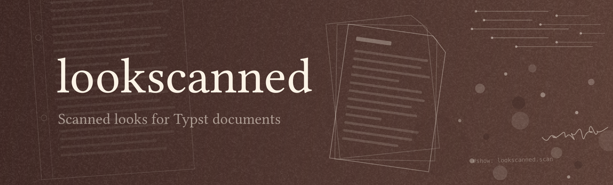
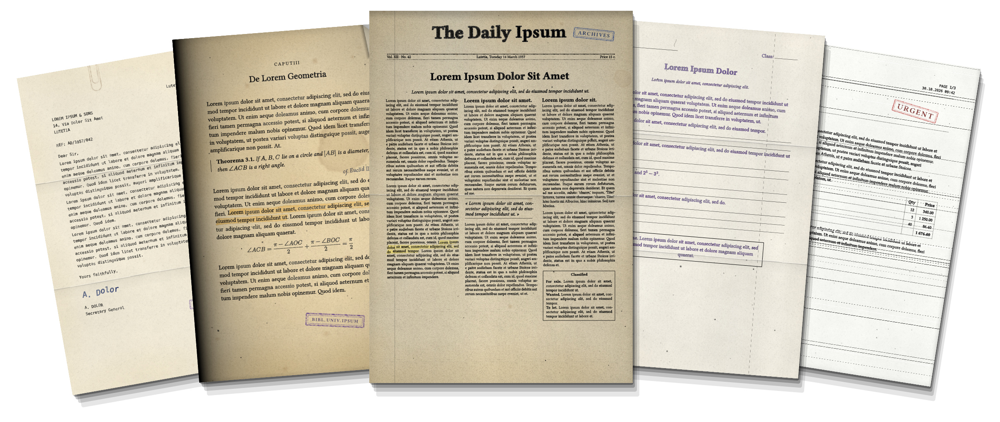
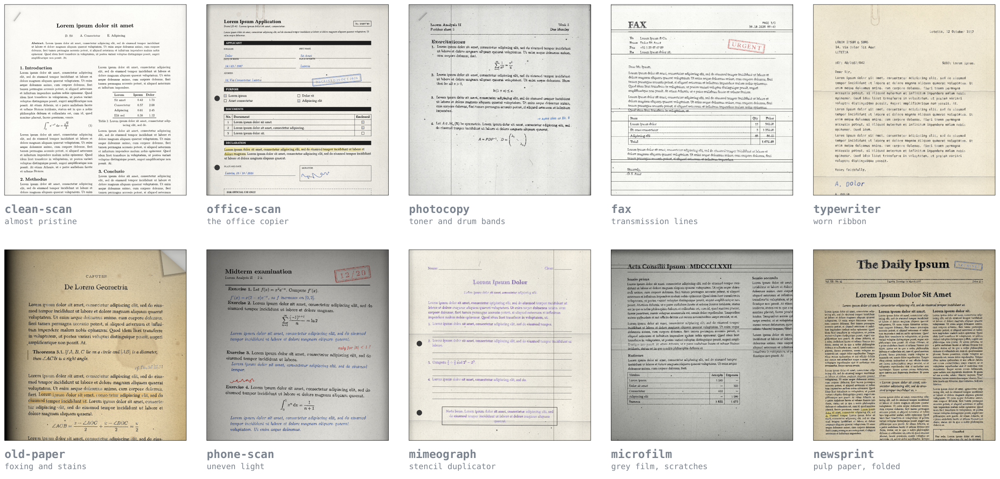
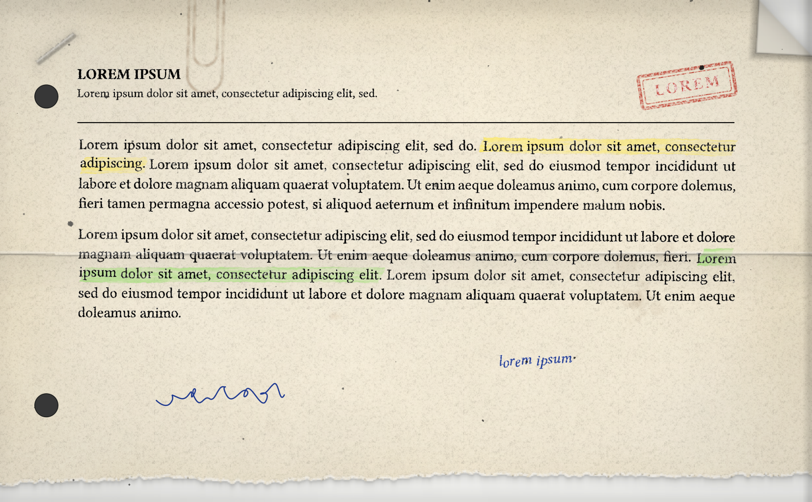

<p align="center">
  <a href="https://github.com/kornstein/lookscanned/actions/workflows/ci.yml"></a>
  <a href="https://kornstein.github.io/lookscanned/"></a>
  <a href="https://typst.app"></a>
  <a href="src/"></a>
  <a href="LICENSE"></a>
</p>

<p align="center">
  <b><a href="https://kornstein.github.io/lookscanned/">Documentation</a></b> ·
  <a href="https://kornstein.github.io/lookscanned/reference/api/">API reference</a> ·
  <a href="examples/">Examples</a> ·
  <a href="CHANGELOG.md">Changelog</a> ·
  <a href="#building-from-source">Contributing</a>
</p>

**lookscanned** turns any Typst document into a convincing scan, photocopy, fax, typewritten letter, stencil copy,
microfilm or yellowed newspaper, with a single show rule. Textures and randomness come from a small Rust plugin
compiled to WebAssembly; the effects themselves are plain Typst.



|  |  |
|---|---|
| **Still real text** | Glyphs are never rasterised: text and equations stay selectable, searchable and copyable. |
| **Same layout** | Page rotation is emulated block by block, without reflow. The test suite checks that every preset keeps the exact line breaks of the clean document. |
| **Reproducible** | Everything derives from an integer `seed`, the page number and the content. |
| **Ten presets, 33 settings** | From a clean office scan to a torn, stapled, coffee-stained memo, with a global `intensity`. |
| **Math-aware** | Equations are inked like the text around them, and templates such as [mousse-notes](https://typst.app/universe/package/mousse-notes/) work out of the box. |

> [!NOTE]
> lookscanned is in early development. If something breaks, please [open an issue](https://github.com/kornstein/lookscanned/issues).

## Quick start

```typst
#import "@preview/lookscanned:0.2.0"

#show: lookscanned.scan.with(preset: "old-paper")
```

Put the rule after your `set page` rules (or just before a template's own show rule), and change the `seed` to get
another copy of the same page.

## Presets



| Preset | Look |
|---|---|
| `clean-scan` | Off-white paper, faint grain, almost straight |
| `office-scan` *(default)* | Moderate grain, edge shadow, slight drift between pages |
| `photocopy` | Heavy toner, drum bands, dust and scratches |
| `fax` | Transmission lines, jittery words, low legibility |
| `typewriter` | Jittery characters, uneven inking, worn ribbon |
| `old-paper` | Yellowing, foxing, stains, vignette |
| `phone-scan` | Strong rotation, uneven lighting |
| `mimeograph` | Stencil-duplicator bleed, punch holes, letter folds |
| `microfilm` | Grey film, deep vignette, scratches |
| `newsprint` | Rough yellowed pulp, folded once |

Each one comes from a full document in [`examples/`](examples/). Tune a preset, scale it, or derive your own:

```typst
#show: lookscanned.scan.with(preset: "fax", intensity: 0.6, ink: (bleed: 0.2))

#let archive = lookscanned.derive("old-paper", edges: (staple: true, folds: 2))
#show: lookscanned.scan.with(preset: archive)
```

## Damage and decorations



```typst
#show: lookscanned.scan.with(
  edges: (staple: true, paperclip: true, dog-ear: true, folds: 1, torn: true, punch-holes: true),
)

#lookscanned.stamp("Received", angle: -9deg)
#lookscanned.highlighter[Grades must be entered before Friday noon]
#lookscanned.scribble(body: "done, 12/03", color: blue)
#lookscanned.stain(at: (x: 80%, y: 60%), size: 25mm, over: true)
```

`page` overrides the effects for a few pages, `region` applies text effects to one block, and `texture` gives you the
raw images. The [documentation](https://kornstein.github.io/lookscanned/) covers every setting, the rendering
pipeline and the known limitations.

## Building from source

You need Rust with the `wasm32-unknown-unknown` target, Typst 0.14 or later and
[just](https://github.com/casey/just). `wasm-opt` (binaryen) and `pdftotext` (poppler) are optional.

```shell
just toolchain      # add the wasm32-unknown-unknown target
just build          # compile the plugin to typst/lookscanned.wasm
just test           # unit tests, compile tests/ and examples/, determinism, layout
just lint           # rustfmt and clippy, warnings as errors
just install-local  # install as @local/lookscanned:<version>
```

<details>
<summary>Packaging, images and documentation</summary>

- `just package` assembles `dist/lookscanned/<version>/` and `just check` compiles a document against it.
- `just publish` copies the package into a clone of [typst/packages](https://github.com/typst/packages)
  (`TYPST_PACKAGES`, default `../typst-packages`).
- `just readme-images` renders the images in `assets/` from the examples, with Ghostscript or [PyMuPDF](https://pymupdf.readthedocs.io).
- `just docs-images` renders the documentation figures (requires Ghostscript).
- `just docs-serve` and `just docs-build` preview and build the [Zensical](https://zensical.org) site.

</details>

During development, documents import the sources directly and are compiled with `typst compile --root .`:

```typst
#import "/typst/lib.typ" as lookscanned
```

The version is defined once in `Cargo.toml`; `typst.toml` is generated from `typst/typst.toml.in`. Changes are
recorded in [CHANGELOG.md](CHANGELOG.md).

<details>
<summary>Project layout</summary>

```
lookscanned
├── src/
│   ├── texture/      # paper, grain, ink, stains, dust, edges, damage, marker
│   ├── rng.rs        # SplitMix64, lattice hash, value noise, fBm
│   ├── params.rs     # CBOR parameters sent by Typst
│   ├── encode.rs     # raster buffer and PNG encoder
│   └── jitter.rs     # seeded random table for per-glyph effects
├── typst/
│   ├── lib.typ       # public API: scan, derive, page, region, texture
│   ├── presets.typ   # neutral values and built-in presets
│   ├── validate.typ  # argument checking, merging, intensity scaling
│   ├── decor.typ     # stamp, stain, scribble, highlighter
│   └── effects/      # page layers, block rotation, ink
├── tests/            # test cases and their runner
├── examples/         # one document per preset; docs/ holds the figure sources
├── docs/             # documentation sources
├── logo/             # banner source
├── CHANGELOG.md
└── justfile
```

</details>

## Credits

The documentation was written with [OpenCode](https://opencode.ai); the code was typed by hand.

lookscanned builds on [wasm-minimal-protocol](https://github.com/astrale-sharp/wasm-minimal-protocol),
[minicbor](https://crates.io/crates/minicbor) and [miniz_oxide](https://crates.io/crates/miniz_oxide).

A "scanned" document is harder to read, so keep a clean version around (`intensity: 0`). lookscanned is meant for
design, fiction, games, props and OCR testing, not for forging documents.

## License

Licensed under the [Apache License 2.0](LICENSE).
